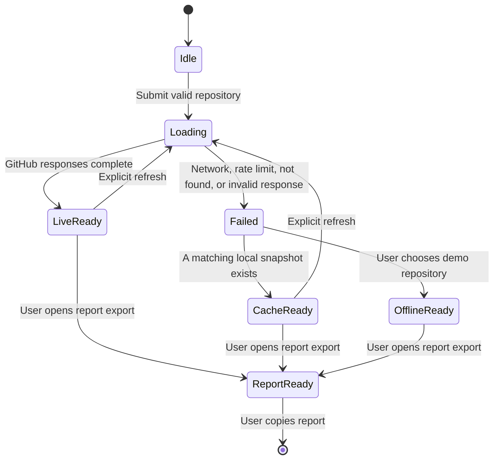

# Data Model: 代码考古局 CodeStrata

**Date**: 2026-11-01

## Overview

The application works with public GitHub metadata only. The internal model intentionally separates the source snapshot from derived insights so live, cached, and offline-demo data can share the same rendering and reporting path.

## Entities

### RepositoryProfile

The public identity and scale of a discovered repository.

| Field | Type | Required | Description |
| --- | --- | --- | --- |
| owner | string | yes | Repository owner login or organization name. |
| name | string | yes | Repository name. |
| fullName | string | yes | `owner/name`. |
| description | string | no | Public repository description. |
| language | string | no | GitHub primary language. |
| license | object | no | License name, SPDX identifier, and public URL; absent means GitHub reports no license. |
| stars | integer | yes | Public star count. |
| forks | integer | yes | Public fork count. |
| sizeKb | integer | yes | GitHub-reported repository size in kilobytes. |
| createdAt | ISO 8601 date-time | yes | Repository creation time. |
| pushedAt | ISO 8601 date-time | yes | Latest public push time. |
| defaultBranch | string | yes | Default branch used to read root contents. |
| openIssues | integer | yes | Public open issue count reported by GitHub. |
| topics | string[] | yes | Public repository topics used to explain the project purpose without guessing. |
| htmlUrl | string | yes | Public repository URL. |

Validation:

- `fullName` MUST be unique within a source snapshot.
- Numeric counts MUST be non-negative integers.
- `createdAt` and `pushedAt` MUST be valid GitHub timestamps.

### RootContentEntry

A root-level repository directory or file shown to orient the user before cloning.

| Field | Type | Required | Description |
| --- | --- | --- | --- |
| name | string | yes | Display name. |
| path | string | yes | Repository-relative path. |
| type | enum | yes | `file` or `dir`. |
| size | integer | no | File size reported by GitHub. |
| htmlUrl | string | yes | Public GitHub entry URL. |

Rules:

- The application MUST NOT download or cache file contents.
- Entry links MUST open the public GitHub page.

### CommitStratum

A monthly aggregation derived from commit metadata.

| Field | Type | Required | Description |
| --- | --- | --- | --- |
| yearMonth | string | yes | UTC calendar month in `YYYY-MM`. |
| commitCount | integer | yes | Count of sampled commits attributed to the month. |
| contributorCount | integer | no | Distinct contributor count when commit authors are available. |
| isGap | boolean | yes | True when `commitCount` is zero and the month is within the repository lifecycle range. |
| gapRunLength | integer | conditional | Length of the consecutive zero-commit run containing this month; required when `isGap` is true. |
| isPeak | boolean | yes | True when the month has the highest sampled commit count and the count is greater than zero. |

Rules:

- `yearMonth` MUST use UTC.
- `commitCount` MUST be non-negative.
- Gap months between the first and last sampled commit MUST retain `isGap=true`; months outside the sampled lifecycle MUST NOT be invented.
- Peak marking MUST be deterministic; when multiple months tie, the earliest month in chronological order is the only peak.

### ReleaseMarker

A public version milestone attached to repository history.

| Field | Type | Required | Description |
| --- | --- | --- | --- |
| id | string | yes | GitHub release identifier or a deterministic offline identifier. |
| name | string | no | Release display name. |
| tagName | string | yes | Version tag. |
| publishedAt | ISO 8601 date-time | yes | Release publication date. |
| htmlUrl | string | yes | Public release URL. |

Rules:

- A release marker is attached to the UTC month containing `publishedAt`.
- Releases without a publish date are ignored in the timeline but counted as “unpublished release records” if present.

### ContributorProfile

A public contributor used for maintenance-concentration analysis.

| Field | Type | Required | Description |
| --- | --- | --- | --- |
| login | string | no | Public login; null/anonymous is allowed only if GitHub reports an anonymous contributor. |
| contributions | integer | yes | GitHub-reported contribution count. |
| htmlUrl | string | no | Public contributor profile link. |

Rules:

- `contributions` MUST be a non-negative integer.
- Anonymous contributors MUST be labeled as anonymous and MUST NOT be silently merged with named accounts.

### RepositoryInsight

The derived report object consumed by the UI and exporter.

| Field | Type | Required | Description |
| --- | --- | --- | --- |
| profile | RepositoryProfile | yes | Repository identity and scale. |
| strata | CommitStratum[] | yes | Chronologically ordered monthly strata. |
| rootContents | RootContentEntry[] | yes | Bounded root-level repository structure. |
| recentCommits | object[] | yes | Latest sampled commit message, author, date, SHA, and public URL. |
| releases | ReleaseMarker[] | yes | Public releases included in the snapshot. |
| contributors | ContributorProfile[] | yes | Public contributors included in the snapshot. |
| topContributorShare | number | no | Share of total reported contributions held by the top contributor, as a percentage with one decimal place. |
| activeMonths | integer | yes | Number of months with commitCount > 0. |
| gapCount | integer | yes | Number of consecutive gap runs inside the sampled lifecycle. |
| peakMonth | string | no | `YYYY-MM` of the deterministic peak. |
| sampledFrom | string | no | Earliest sampled commit date in ISO 8601. |
| sampledTo | string | no | Latest sampled commit date in ISO 8601. |
| isSampledHistory | boolean | yes | True when the application did not read the full commit history. |

Rules:

- `topContributorShare` MUST only be computed from the contributor snapshot and MUST be labeled as such in the report.
- `activeMonths`, `gapCount`, and `peakMonth` MUST be derived from `strata`, not independently recalculated by the UI.

### DataSnapshot

The provenance envelope stored and rendered by the app.

| Field | Type | Required | Description |
| --- | --- | --- | --- |
| sourceType | enum | yes | One of `live`, `cache`, or `offline-demo`. |
| sourceName | string | yes | Human-readable source label. |
| fetchedAt | ISO 8601 date-time | yes | Snapshot retrieval or demo-capture time. |
| cacheKey | string | conditional | Stable repository cache key; required for `live` and `cache`. |
| schemaVersion | integer | yes | Internal snapshot schema version. |
| insight | RepositoryInsight | yes | Derived insight. |

Rules:

- Every UI result MUST include `sourceType`, `sourceName`, and `fetchedAt`.
- Cache read MUST not silently convert into `live`.
- Offline demo MUST remain `offline-demo` even if it resembles a real repository.

### ReportDraft

The user-visible export artifact generated from a `DataSnapshot`.

| Field | Type | Required | Description |
| --- | --- | --- | --- |
| repository | string | yes | Public `owner/name`. |
| markdown | string | yes | Structured Markdown text. |
| sections | string[] | yes | Present section titles, including facts, risk, recommendations, and provenance. |
| createdAt | ISO 8601 date-time | yes | Report generation time. |

Rules:

- The report MUST include provenance copied from `DataSnapshot`.
- Recommendations MUST be distinguishable from verifiable facts.
- The report MUST NOT include private data or source-code contents.

## State Transitions

Failure states MUST preserve the previous visible snapshot when one exists. Offline mode MUST remain explicitly labeled.

## Derived Metrics

| Metric | Formula | Display rule |
| --- | --- | --- |
| Active months | Count of strata where `commitCount > 0` | Show as integer months. |
| Gap count | Count of consecutive zero-commit runs inside the sampled lifecycle | Show as “断层” count. |
| Peak month | Earliest month with maximum commit count | Show month and commit count. |
| Top contributor share | Top contributor contributions / sum of contributor contributions × 100 | Label as contributor snapshot percentage. |
| Timeline span | Earliest to latest sampled commit or release month | Show bounded sample span when full history is unavailable. |
